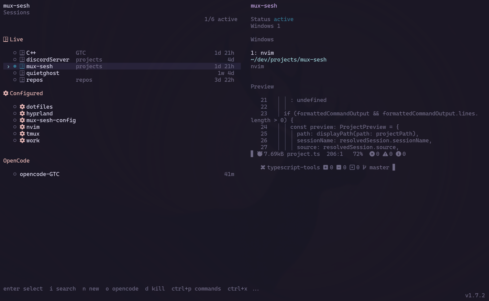

# mux-sesh

Keyboard-driven tmux session and Herdr workspace switching from a terminal UI.

<p align="center">
  
</p>

## Why mux-sesh

- Switch between live tmux sessions or Herdr workspaces without leaving the keyboard.
- Launch local projects from a single, searchable picker.
- Keep reusable project rules in config instead of shell scripts.
- See what Enter will do before it runs, and review every close before anything is closed.

## Quick Start

`mux-sesh` runs on Bun and talks directly to tmux or Herdr. Herdr needs no mux-sesh plugin.

Prerequisites:

- [Bun](https://bun.sh) 1.3.14 or newer
- [tmux](https://github.com/tmux/tmux/wiki) or Herdr 0.7.5 or newer
- [git](https://git-scm.com) for cloning GitHub repositories from the new-session flow

Install globally:

```bash
bun install -g mux-sesh
```

Run it:

```bash
mux-sesh
```

Recommended tmux binding:

```tmux
bind-key -n M-w popup -E -w 62% -h 70% "mux-sesh"
```

Reload tmux after adding the binding:

```bash
tmux source-file ~/.tmux.conf
```

## How It Works

- Sessions view shows live tmux sessions or Herdr workspaces, plus listed configured targets.
- Projects view shows scanned or configured directories.
- New is project-first: a summary row names exactly what Enter will do (create, focus, or
  clone), and Enter runs that plan. A project already open in the same directory is focused.
- New's steps rename the planned session (`ctrl+n`), change its startup command (`ctrl+t`),
  create a named session in the directory you started from (`ctrl+g`), or open a file found with
  [fff](https://github.com/dmtrKovalenko/fff) (`ctrl+o`).
- Pasting a GitHub URL into New clones it into `repos_path`. URLs with credentials are refused,
  an existing destination is reused only after it is verified, and nothing is ever deleted.
- Closing is reviewed: `d` shows exactly what will close, and `m` marks rows for a reviewed batch
  close. Only tmux sessions or Herdr workspaces are closed; no files, worktrees, or branches are
  deleted.
- The details panel is compact by default; Toggle details (`v`) inspects the selected row.
- The Agents section lists tmux agent sessions and each Herdr agent pane; Herdr agent panes are
  read-only here.

Full walkthroughs: [docs/workflows.md](docs/workflows.md)

Herdr concepts map directly into the UI:

| mux-sesh | Herdr     |
| -------- | --------- |
| Session  | Workspace |
| Window   | Tab       |
| Pane     | Pane      |

Backend detection uses `HERDR_ENV=1`, then `TMUX`, then an explicit `backend`. Without one,
auto detection prefers a running, protocol-compatible Herdr, then installed tmux (whether or not
its server is running). An explicit `backend` checks only that backend and never falls back.

```json
{ "backend": "herdr" }
```

Explicit Herdr selection is strict: its server must already run, and mux-sesh never starts it.
If a backend is unusable, a startup screen says why and `r` retries. Config changes apply on the
next mux-sesh launch.

## Minimal Configuration

Config lives at `~/.config/mux-sesh/config.json`.

```json
{
  "project_paths": ["~/dev"],
  "repos_path": "~/dev/repos",
  "keybind_mode": "vim",
  "prefix_key": "ctrl+x",
  "theme": "rosepine",
  "default_session": {
    "startup_command": "nvim"
  }
}
```

Full configuration reference: [docs/configuration.md](docs/configuration.md). For editor
completion, [`mux-sesh.schema.json`](mux-sesh.schema.json) is generated from the same contract
that validates the config at startup.

## Essential Keys

Default mode is `vim`, with `ctrl+x` as the prefix for secondary actions.

<!-- keys: vim normal subset -->

| Key        | Action                                                                |
| ---------- | --------------------------------------------------------------------- |
| `enter`    | Open the selected row: focus a live session, or create from a project |
| `i`        | Search                                                                |
| `n`        | New session                                                           |
| `d`        | Review closing the selected session, or the marked rows               |
| `m`        | Mark or unmark a row for a batch close                                |
| `v`        | Toggle details                                                        |
| `ctrl+x s` | Show sessions                                                         |
| `ctrl+x p` | Show projects                                                         |
| `ctrl+x r` | Rename session                                                        |
| `ctrl+p`   | Command palette; type `theme` for the theme picker                    |

Move with `j` / `k`, open a visible row with `1`–`9`, and quit with `q` or `esc`. In text fields,
letters type; only arrows, `enter`, `esc`, and `ctrl+…` keys act.

Full keybinding reference, including standard mode: [docs/keybindings.md](docs/keybindings.md)

## Crash recovery

mux-sesh disables OpenTUI's automatic error console so a crash cannot trap the terminal. When the
UI fails, a recovery screen shows a diagnostics report: `c` copies it, `o` reviews sharing it as
a prefilled GitHub issue (nothing is sent unless you confirm), `r` retries, and `q` quits.
Redaction is pattern-based, so read the report before sharing. Opening the prefilled issue sends
it to github.com and your browser history even if you never submit it.

Uncaught errors outside the UI restore the terminal, print the report, and exit with status 1. A
native crash or `SIGKILL` cannot show either. Details: [Crash Recovery](docs/workflows.md#crash-recovery)

## Docs

- [Configuration](docs/configuration.md)
- [Themes](docs/themes.md)
- [Keybindings](docs/keybindings.md)
- [Workflows](docs/workflows.md)

## Development

```bash
bun install
bun run typecheck
bun test
```

Use `bun run build` only when you need the compiled binary in `dist/mux-sesh`.

## License

MIT. See [LICENSE](LICENSE).

## Related

- [mux-manager](https://github.com/quiet-ghost/mux-manager) for Telescope-based tmux session management inside Neovim
- Built with [OpenTUI](https://github.com/anomalyco/opentui)
